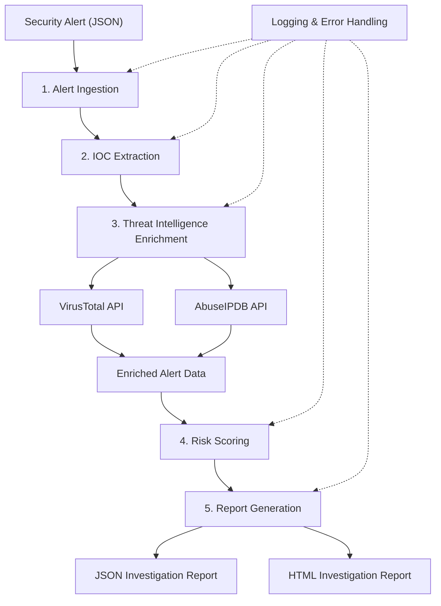

# SOC Alert Enrichment & Investigation Automation
## System Architecture

### 1. Overview

This project automates the initial investigation of security alerts by normalizing alert data, extracting Indicators of Compromise (IOCs), enriching indicators with threat intelligence, calculating a risk score, and generating investigation reports.

### 2. Architecture Diagram

### 3. Pipeline Components

| Component | File | Responsibility |
|---|---|---|
| Alert Ingestion | `alert_ingestion.py` | Validates and normalizes incoming alerts |
| IOC Extraction | `ioc_extractor.py` | Extracts IPs, URLs, domains and file hashes |
| Threat Intelligence | `threat_intel.py` | Queries VirusTotal and AbuseIPDB |
| Risk Scoring | `risk_scoring.py` | Calculates a rule-based triage score |
| Report Generation | `report_generator.py` | Creates JSON and HTML reports |
| Orchestration | `main.py` | Executes the complete investigation workflow |

### 4. Threat Intelligence Sources

**VirusTotal**
- Retrieves IP reputation and malicious detection statistics.
- Uses the VirusTotal API.
- API failures are handled without treating missing data as malicious evidence.

**AbuseIPDB**
- Retrieves IP abuse confidence scores and historical report information.
- Uses a 90-day reporting window.
- Provider availability is tracked separately from risk scoring.

### 5. Risk Scoring

The risk score considers:

- Alert severity.
- VirusTotal malicious detection count.
- AbuseIPDB confidence score.
- Historical abuse report volume, subject to a confidence threshold.

The final score uses the highest individual IP intelligence score, added to the alert severity score, with a maximum of 100.

Threat intelligence provider availability contributes zero risk points.

Risk classifications:

| Score | Classification |
|---|---|
| 0-24 | Low |
| 25-49 | Medium |
| 50-74 | High |
| 75-100 | Critical |

This is a rule-based triage score, not a probability of compromise.

### 6. Outputs

The pipeline generates:

- `investigation_report.json`
- `investigation_report.html`

These reports provide alert details, extracted indicators, enrichment results, risk assessment and investigation recommendations.

### 7. Reliability and Testing

The project includes:

- Input validation.
- Error handling and logging.
- Offline mock threat intelligence mode.
- Unit tests.
- Integration tests.
- Full pipeline tests.

The automated test suite currently contains 23 passing tests.

### 8. Security Considerations

- API keys are stored in environment variables.
- `.env` is excluded from Git.
- Offline test mode avoids external API calls.
- Reserved and non-public IP addresses are excluded from public threat intelligence lookups.
- No automated blocking, isolation or containment actions are performed.

### 9. Project Limitations

This is a portfolio and lab automation project. It is not a replacement for a production SIEM or a human-led incident response process.

Risk scores and external intelligence results should be validated by an analyst before making security decisions.
